

  

<h1 align="center">HandKess Social Radar</h1>

  <b>Analysetool für Portfolio- und Wettbewerbsanalysen von Social-Media-Kanälen – direkt im Browser.</b> 
  Chrome-Erweiterung · YouTube · Instagram · TikTok · Facebook · lokal, ohne Cloud und ohne Tracking

  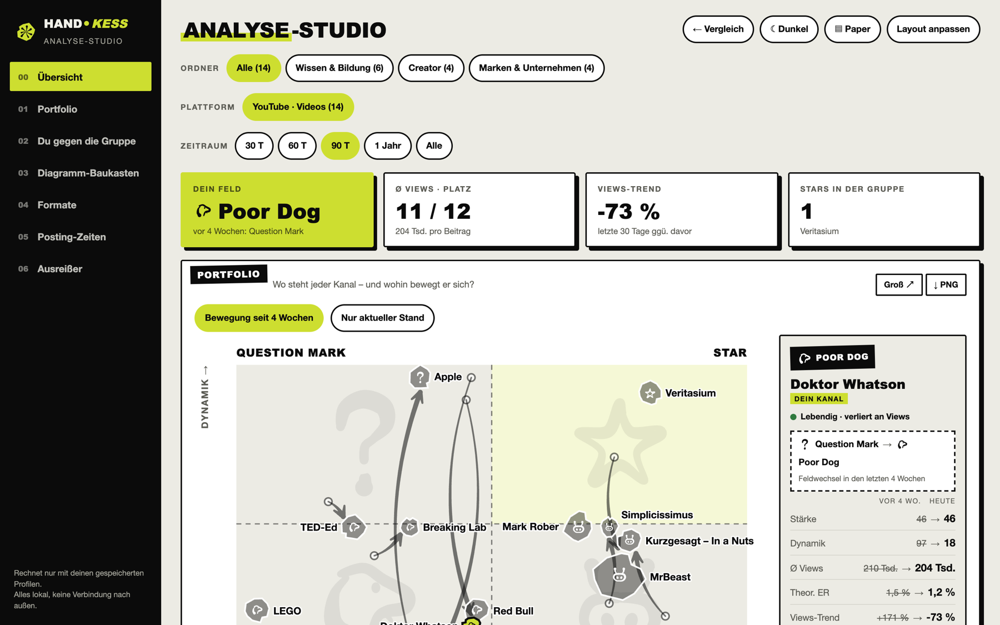

> **Status: in Entwicklung – Forschungsprojekt.** Das Social Radar ist ein privates Werkzeug, an dem ich aktuell arbeite. Es dient einer Untersuchung: **An welchen Kennzahlen lässt sich die Entwicklung eines Kanals frühzeitig erkennen, und welche geben verlässlich Auskunft über seinen Lebenszyklus – absolut und im Vergleich zu anderen Kanälen?** Die Berechnungen sind bewusst offen dokumentiert, aber noch nicht feinjustiert. Wie stark etwa die theoretische Engagement-Rate gegenüber den Views zählen sollte, ist genau eine der offenen Fragen; die Gewichte sind ein erster, begründeter Vorschlag und werden mit echten Verläufen geprüft.

> **English summary:** HandKess Social Radar is a Chrome extension (Manifest V3) for portfolio and competitor analysis of social media channels, currently in development as part of a research project on which metrics reliably indicate a channel's development and life cycle. It overlays rankings and KPIs directly on YouTube, Instagram, TikTok and Facebook pages, lets you save your own and third-party channels into folders, compares them in a dashboard and places them in a BCG-style portfolio matrix (Star, Question Mark, Cash Cow, Poor Dog) including their movement over the last four weeks. All data stays in the local browser storage; the only network connection is the official YouTube Data API with the user's own key. UI and documentation are in German.

---

## Worum es geht

Wer Kanäle verantwortet, will sie steuern: Wo stehen die eigenen Kanäle, wie entwickeln sie sich, wo gibt es Lücken und Potenzial – und was machen andere gut oder schlecht? Das Social Radar ist ein Analysetool genau dafür:

- **Eigene und fremde Kanäle überwachen** – Entwicklung, Reichweite, Engagement und Aktivität im Zeitverlauf.
- **Portfolio und Wettbewerb lesen** – jeder Kanal im Vergleich zu einer selbst gewählten Gruppe, eingeordnet als Star, Question Mark, Cash Cow oder Poor Dog.
- **Inhalte besser platzieren** – welche Formate, Themen und Posting-Zeiten bei wem funktionieren, welche Beiträge weit über dem Normalniveau laufen.
- **Entwicklungen und Plattformtrends frühzeitig erkennen** – Bewegungen in der Matrix, aufkommende Formate und Verschiebungen auf der Plattform werden sichtbar, bevor sie in den Gesamtzahlen auffallen.

Die Analyse passiert dort, wo man ohnehin arbeitet: auf der Kanalseite selbst. Gespeicherte Kanäle landen im Vergleichs-Dashboard und im **Analyse-Studio**, das sie wie ein Portfolio führt.

## Forschungsfrage und offene Punkte

Das Tool ist zugleich Werkzeug und Versuchsaufbau für die Frage, welche KPIs die Lage und den Lebenszyklus eines Kanals wirklich beschreiben. Offen und in Arbeit sind unter anderem:

- **Gewichtung:** Wie stark sollen Views, theoretische Engagement-Rate und Reichweite in die Stärke eines Kanals eingehen – und wie Views-Trend, Follower-Wachstum und ER-Trend in seine Dynamik?
- **Verknüpfung der Kennzahlen:** Engagement ohne Bezug zur Reichweite (und umgekehrt) erzählt nur die halbe Geschichte; gesucht sind Kombinationen, die zusammen aussagekräftig sind.
- **Robustheit:** Ein einzelner viraler Beitrag kann den Durchschnitt verzerren – Median oder Durchschnitt, und über welchen Zeitraum?
- **Lebenszyklus-Signale:** Welche Muster (Aktivität, Rhythmus, Wachstum, Community-Bindung) kündigen Aufstieg, Plateau oder Rückgang an?

Die aktuelle Methodik steht vollständig in [docs/KENNZAHLEN.md](docs/KENNZAHLEN.md).

## Funktionen

### 1. Radar direkt auf der Plattform
- **Rangliste statt Raster:** Beiträge eines Kanals nach den besten oder schlechtesten sortieren – nach theoretischer Engagement-Rate, Reichweite, Views, Likes, Kommentaren oder Views pro Tag, gefiltert nach 30/60/90 Tagen oder einem Jahr.
- **Kanal-Kennzahlen auf einen Blick:** Follower, Ø Views, Ø Engagement-Rate, Reichweiten-Score.
- **Overlays auf den Vorschaubildern** mit Rang und Ampel; eine einklappbare Leiste am einzelnen Video mit Einordnung im Kanal.
- **Format-Hashtags:** eigene Formate vergeben (z. B. `#tutorial`, `#hook-frage`) und auswerten, welches Format trägt.
- **Marker:** Stand eines Kanals festhalten und später die Entwicklung sehen.
- **Views-Schätzung** für Beiträge ohne öffentliche Views (Instagram-Bilder, Facebook-Fotos) – als Spanne, mit Selbsttest, nie mit echten Zahlen vermischt.

| Kanalseite mit Rangliste | Eingeklappt: Rang und ER auf jedem Vorschaubild |
|---|---|
| 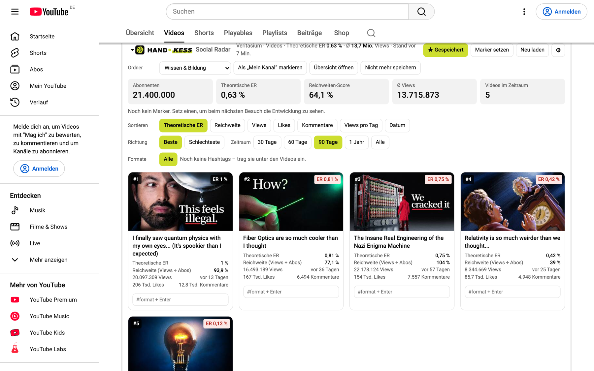 | 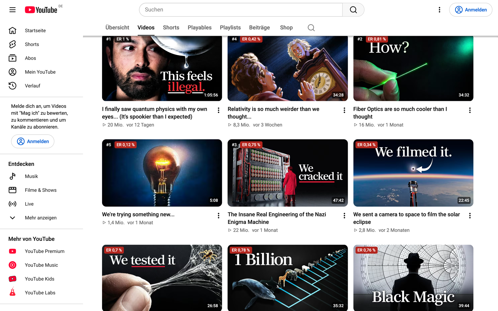 |

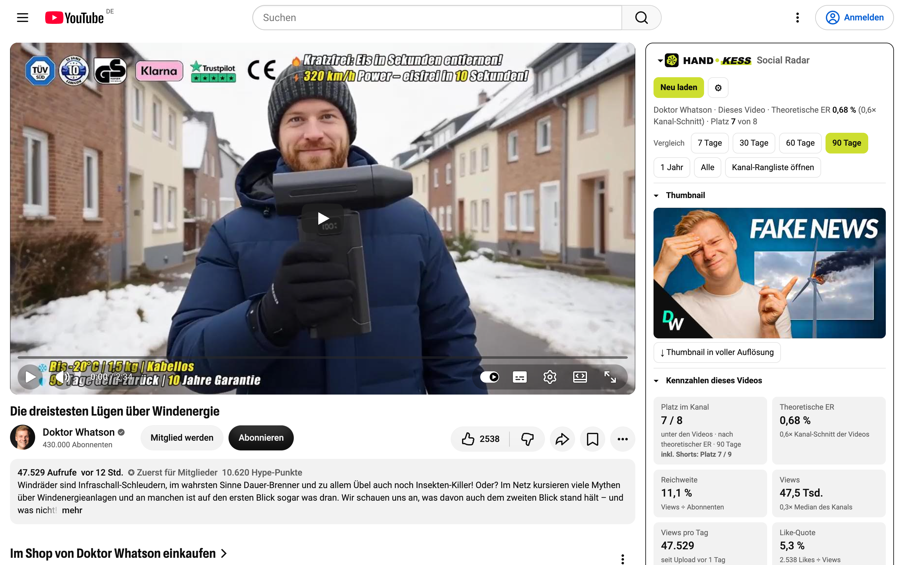

### 2. Vergleichs-Dashboard
- Nur selbst gespeicherte Kanäle, in eigenen Ordnern (z. B. „Wissen & Bildung“, „Creator“, „Marken & Unternehmen“).
- Kanal-Score mit Ampel im Vergleich zur Gruppe, Trend, Top-Formate, Abstand zum eigenen Kanal.
- Entwicklung über die Zeit aus wöchentlichen Ständen.

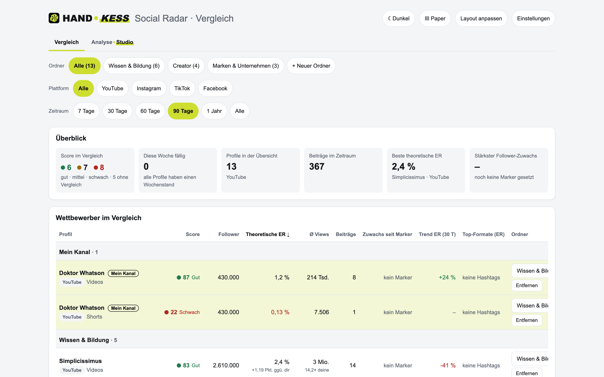

### 3. Analyse-Studio
Eine eigene Analyse-Seite im HandKess-Stil. Gerechnet wird immer je Plattform und Bereich, weil Views zwischen Plattformen nicht vergleichbar sind.

| Modul | Frage, die es beantwortet |
|---|---|
| **Portfolio** | Wo steht jeder Kanal – Star, Question Mark, Cash Cow oder Poor Dog – und wohin hat er sich in den letzten vier Wochen bewegt? Beim Überfahren öffnet sich ein Datenfeld mit Kennzahlen, Status (lebendig bis inaktiv) und Vorher-Nachher-Vergleich. |
| **Du gegen die Gruppe** | Wo liegt der eigene Kanal vorn, wo fehlt etwas? (Netzdiagramm aus sechs Rängen) |
| **Diagramm-Baukasten** | Eigene Ansichten bauen: Kennzahl gegen Kennzahl oder als Rangliste, speicherbar. |
| **Formate** | Welches Format funktioniert bei welchem Kanal? (Heatmap) |
| **Posting-Zeiten** | Zu welchen Wochentagen und Uhrzeiten bekommen Beiträge die meisten Interaktionen? |
| **Ausreißer** | Welche Beiträge liefen in den letzten 30 Tagen weit über dem Normalniveau ihres Kanals? |

Jede Grafik lässt sich als PNG exportieren. Hell/Dunkel, Paper-Look und verstellbare Kacheln sind eingebaut.

| Portfolio mit Datenfeld | Du gegen die Gruppe |
|---|---|
| 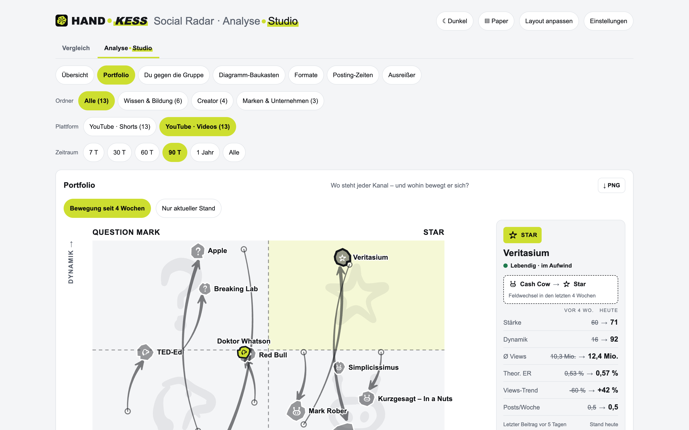 | 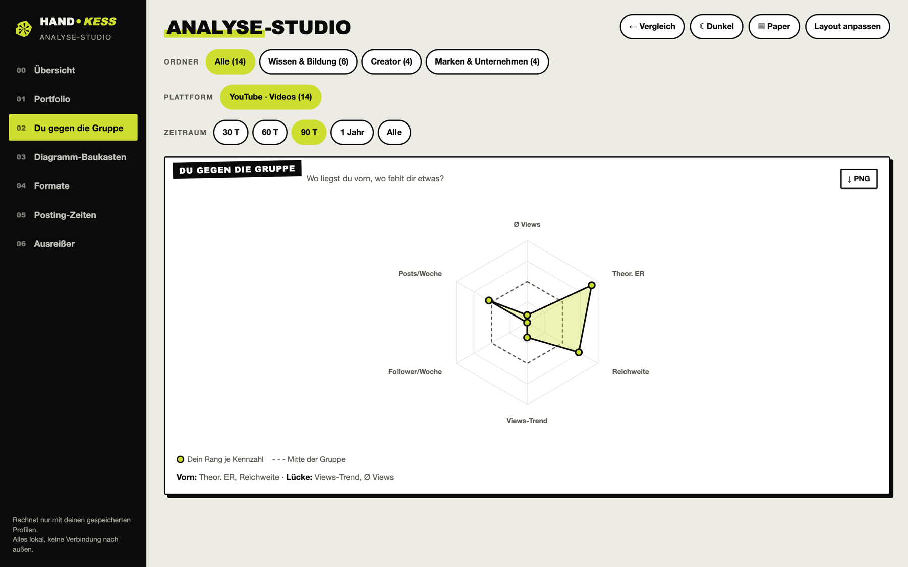 |
| **Diagramm-Baukasten** | **Posting-Zeiten** |
| 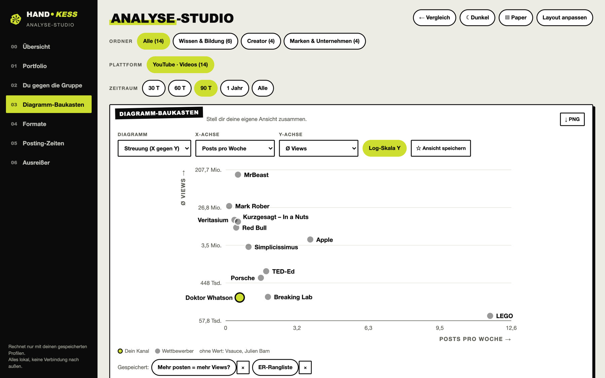 | 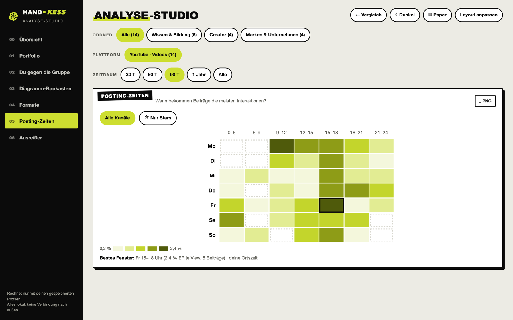 |
| **Ausreißer** | **Dunkler Modus** |
| 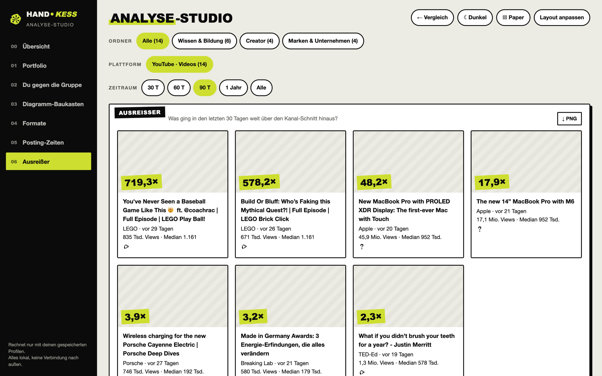 | 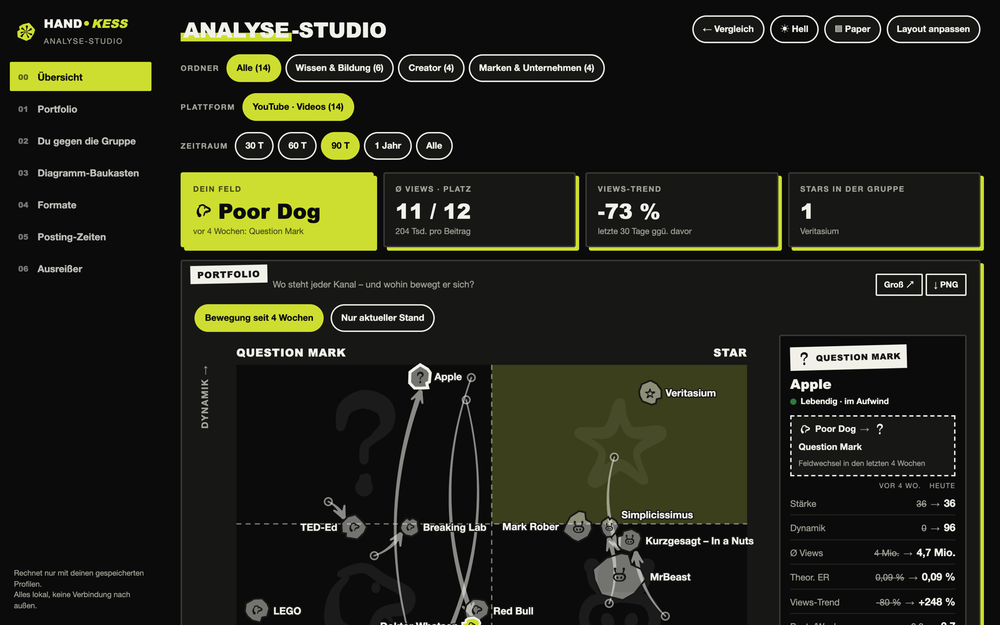 |

**So ist das Portfolio zu lesen:** Die Matrix ist ein Ausgangspunkt für die Analyse, kein Urteil. Ein „Poor Dog“ ist kein Kanal, den man aufgeben sollte, sondern einer, bei dem sich ein genauerer Blick lohnt. Ein etablierter Wissenskanal mit treuer Community, stabilen Views und wenigen, aufwendigen Videos wächst vielleicht nicht mehr stark und erfüllt seinen Zweck trotzdem. Die Frage ist dann eher, ob und wie er sich weiterentwickeln soll. Die Einordnung braucht immer den Kontext: Thema, Zielgruppe, Veröffentlichungsrhythmus und Auftrag des Kanals.

Wie die Kennzahlen und das Portfolio berechnet werden, steht ausführlich in **[docs/KENNZAHLEN.md](docs/KENNZAHLEN.md)**.

## Installation

Die Erweiterung ist nicht im Chrome Web Store, sondern wird entpackt geladen:

1. Repository herunterladen oder klonen.
2. In Chrome `chrome://extensions` öffnen und oben rechts den **Entwicklermodus** einschalten.
3. **„Entpackte Erweiterung laden“** wählen und den Ordner des Repositorys auswählen.
4. Für YouTube einen eigenen, kostenlosen API-Schlüssel hinterlegen (Einstellungen der Erweiterung):
   1. In der [Google Cloud Console](https://console.cloud.google.com) ein Projekt anlegen.
   2. „APIs & Dienste“ → „Bibliothek“ → **YouTube Data API v3** aktivieren.
   3. „Anmeldedaten“ → „API-Schlüssel“ erstellen und auf die YouTube Data API v3 beschränken.
   4. Schlüssel in den Einstellungen einfügen, speichern, testen.
5. Einen YouTube-Kanal öffnen – das Radar erscheint über den Videos. Mit **„☆ Speichern“** landet der Kanal im Dashboard; ein Klick auf das Erweiterungs-Symbol öffnet den Vergleich, von dort geht es ins **Analyse-Studio**.

Instagram, TikTok und Facebook brauchen keinen Schlüssel: Das Radar liest dort nur die Zahlen mit, die die Seite im Browser ohnehin lädt.

## Datenschutz und Grundsätze

- **Alles bleibt lokal** im Speicher des Browsers. Keine eigene Cloud, kein Konto, keine Telemetrie.
- **Einzige Netzwerkverbindung:** die offizielle YouTube Data API (`googleapis.com`) mit dem eigenen Schlüssel – im Kopf der Anfrage, nicht in der Adresse.
- **Keine eigenen Abrufe** bei Instagram, TikTok und Facebook; kein Crawling im Hintergrund, keine Umgehung von Schutzmechanismen.
- **Private Facebook-Profile sind gesperrt**, LinkedIn ist bewusst nicht unterstützt.

Details in **[DATENSCHUTZ.md](DATENSCHUTZ.md)**. Die Nutzungsbedingungen der jeweiligen Plattform gelten weiterhin; die Erweiterung ist ein Analyse-Werkzeug für öffentlich sichtbare Zahlen.

## Technik

- Chrome-Erweiterung, Manifest V3, reines JavaScript ohne Frameworks oder Bibliotheken.
- Diagramme als eigenes SVG, Panels in Shadow DOM, damit sie die Plattform-Seite nicht beeinflussen.
- Aufbau, Datenfluss und Speicher: **[docs/ARCHITEKTUR.md](docs/ARCHITEKTUR.md)** · Versionen: **[CHANGELOG.md](CHANGELOG.md)**

## Hinweis zu den Screenshots

Die Screenshots zeigen **öffentlich sichtbare Zahlen echter YouTube-Kanäle** (Stand November 2026), ausgewählt als bunte Mischung aus Wissenskanälen, Creatorn und Unternehmen. „Doktor Whatson“ ist dabei nur als Beispiel für die Funktion „Mein Kanal“ markiert. Es besteht keine Verbindung oder Kooperation mit einem der gezeigten Kanäle; die Einordnungen sind automatische Berechnungen und keine Bewertung.

## Entstehung

Idee, Konzept, Anforderungen, Methodik und Kennzahlen sowie die Steuerung der Entwicklung, Tests und Abnahme jeder Version: **André Glebe**. Bei der Programmierung und technischen Umsetzung habe ich mit KI-Unterstützung gearbeitet (Claude von Anthropic).

## Lizenz

Copyright © 2026 André Glebe (HandKess). **Alle Rechte vorbehalten** – der Code ist zur Ansicht veröffentlicht. Nutzung, Weitergabe oder Veränderung nur mit schriftlicher Erlaubnis. Siehe [LICENSE](LICENSE).
